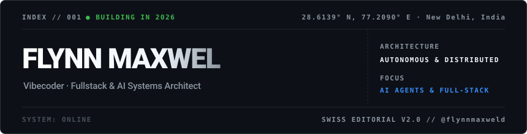

  

> **"Designing, building, and automating intelligent applications from New Delhi, India."**

  

---

### ⚙️ Systems &amp; Stack Architecture

| Domain | Stack &amp; Technologies |
| :--- | :--- |
| **Core & Languages** |     |
| **Frameworks & Web** |     |
| **Systems & Cloud** |     |
| **AI & Automation** |    |

---

### 📂 /selected-works

- [**`flynnmaxweld.github.io`**](https://flynnmaxweld.github.io) &mdash; Personal space, interactive experiments & engineering notes
- [**`AI & Automation Agents`**](https://github.com/flynnmaxweld) &mdash; Autonomous agent pipelines, LLM utilities, and fullstack tools
- [**`github.com/flynnmaxweld`**](https://github.com/flynnmaxweld) &mdash; All open-source repositories & experiments

---

### 🛰️ /telemetry &amp; connect

 &nbsp;  &nbsp; 
