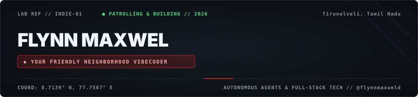

  

> *"With great compute comes great velocity."*
>
> Designing, building, and automating intelligent applications from **Tirunelveli, Tamil Nadu**.

### 🕸️ Patrol &amp; Commit Telemetry

  

---

### ⚡ Web-Shooters &amp; Lab Gear

| Gear Category | Technologies &amp; Tools |
| :--- | :--- |
| **Languages** |     |
| **Frameworks & Web** |     |
| **Systems & Cloud** |     |
| **AI Lab & Agents** |    |

---

### 🎒 Experiments &amp; Deployments

- [**`flynnmaxweld.github.io`**](https://flynnmaxweld.github.io) &mdash; Personal lab, interactive experiments & indie notes
- [**`Autonomous Agent Pipelines`**](https://github.com/flynnmaxweld) &mdash; Intelligent automated systems, agent swarms & fullstack utilities
- [**`github.com/flynnmaxweld`**](https://github.com/flynnmaxweld) &mdash; All open-source repositories &amp; lab prototypes

---

### 📻 Radio Frequencies

 &nbsp;  &nbsp; 
