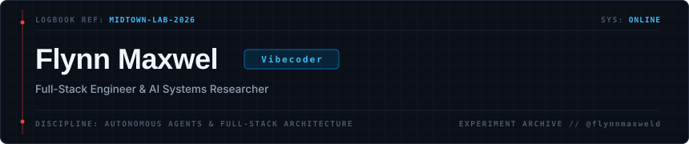

  

> **"Building intelligent systems, autonomous agent workflows, and resilient web applications."**

### 📊 Research Activity &amp; Commit Logs

  

---

### 🛠️ Systems &amp; Lab Architecture

| Technical Domain | Frameworks, Languages &amp; Tooling |
| :--- | :--- |
| **Languages** |     |
| **Web & APIs** |     |
| **Systems** |     |
| **AI & Intelligence** |    |

---

### 📂 Research Prototypes &amp; Deployments

- [**`flynnmaxweld.github.io`**](https://flynnmaxweld.github.io) &mdash; Personal research lab, interactive experiments & notes
- [**`Autonomous Agent Pipelines`**](https://github.com/flynnmaxweld) &mdash; Intelligent automated workflows, multi-agent frameworks & tools
- [**`github.com/flynnmaxweld`**](https://github.com/flynnmaxweld) &mdash; All open-source repositories &amp; experiments

---

### 🔗 Contact &amp; Channels

- [**Web Hub**](https://flynnmaxweld.github.io)
- [**LinkedIn**](https://linkedin.com/in/flynnmaxwel)
- [**Email**](mailto:flynnmaxweld@gmail.com)
